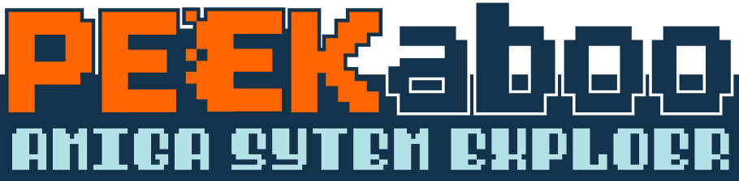

# Peekaboo



**Peekaboo** is an Amiga disk tool, emulator and debugger in one desktop application. Open a disk
image and look inside it block by block, fix it, identify it, then boot it in the built-in
emulator and take the running machine apart: CPU, Copper, Blitter, sprites, audio, disk DMA and
memory, frame by frame. It is built with C++20, Dear ImGui and the PUAE (libretro-uae) emulation
core, and runs on Windows (it also builds on macOS).

Peekaboo ships **no Kickstart ROMs, Workbench or AmigaOS disks**. Bring your own; the setup
wizard finds them for you (see [Emulator setup](#emulator-setup)).

**Download:** [Releases](https://github.com/AdamKeher/peekaboo/releases) ·
**Website:** [demoscene.au/peekaboo](https://demoscene.au/peekaboo)

- [Getting started](#getting-started)
- [Disks](#disks)
- [The emulator](#the-emulator)
- [Real floppy drives](#real-floppy-drives)
- [The debugger](#the-debugger)
- [Working with other tools](#working-with-other-tools)
- [Emulator setup](#emulator-setup)
- [Building](#building)
- [License](#license)

## Getting started

1. Download the zip from [Releases](https://github.com/AdamKeher/peekaboo/releases) and unzip it
   anywhere. Everything Peekaboo needs is in that folder, including the emulator core in
   `emulation\`.
2. Run `peekaboo.exe`. Peekaboo is not code-signed, so Windows may show a SmartScreen warning the
   first time - see [First start on Windows](#first-start-on-windows).
3. Pick a screen profile (Lores or Hires layouts, for smaller and larger screens), then let the
   **setup wizard** find your Kickstart ROMs and Workbench media.
4. Drag an `.adf` (or `.dms`, `.ipf`, `.scp`, `.zip`, ...) onto the window, or use
   *File > Open Disk Image*. *Emulator > Run* boots it.

## Disks

### What opens

| Kind | Formats |
|---|---|
| Floppy images | ADF (including the extended UAE-1ADF format), DMS, IPF, SCP flux images, and any of them in a ZIP |
| Hard drives | HDF / HDZ hardfiles, and host directories mounted as Amiga drives (*File > Mount Host Directory*) |
| WHDLoad | LHA / LZH / LZX archives and slaves, booted straight from the archive |
| CD | CUE, CCD, MDS, NRG, CHD, ISO, and 7z / ZIP sets of them (CD32, CDTV) |
| New disks | Blank OFS / FFS disks (plain, International, Directory Cache, long names) from *File > New Disk* |

IPF needs the SPS/CAPS `capsimg` plugin in `emulation\`; without it an IPF image says so instead
of opening. Several disks can be open at once (*Disk > Disk Images*), and a **session** (`.peek`)
saves them together with the window layout.

### File browser
A file manager for OFS / FFS disks: browse directories, see sizes, dates and protection bits,
select with `Shift`/`Ctrl`+click, drag files between directories or out to the host, and rename,
delete, create folders, change protection bits (R/W/E/D) and export from the context menu or the
*Edit* menu. *Edit > Restore* brings back a deleted file; *Edit > Scrub* deletes one and zeroes
every block it used.

### Hex editor and block details
- Hex and ASCII side by side, with hex (`DE AD BE EF`) and text search, *Advanced Find*, and
  jumps to any block, the boot block or the root block, with Back / Forward history.
- Edit bytes in place, with modified bytes marked and undo.
- **Block Details** decodes the block under the cursor from JSON definitions (`definitions/`):
  boot block, root block, file header, data, bitmap and the rest - numbers, flags, Amiga dates
  and BCPL strings. Hovering a field highlights its bytes; fields that point at other blocks
  (`next_hash`, `parent`, `extension`, ...) are links.

### Maps and validation
- **Block Type Map**, **Disk Bitmap**, **Block Change Map** and **NDOS Map** show the whole disk
  at once: what each block is, what the bitmap says, what changed, and the non-DOS tracks.
- The **Disk Validator** checks the boot block (DOS signature, checksum, root pointer), the root
  block, the allocation bitmap (blocks in use but marked free, and allocated but empty), and walks
  every file and directory for broken chains, loops and bad hash tables.

### Identifying a disk
- **Boot blocks** are fingerprinted against a brainfile database: standard boot blocks, loaders,
  intros and known **boot block viruses**. The *Boot Block Viewer* runs a boot block's code in an
  emulator of its own and shows what it draws. The boot block library in `bootblocks/` comes from
  [AmigaBootBlockReader](https://github.com/jasonthesmith79/AmigaBootBlockReader) by
  jasonthesmith79, used with permission.
- **TOSEC**: disks are looked up by hash in the TOSEC catalogue, and the **TOSEC Browser**
  searches and filters the whole Amiga set.
- **ScreenScraper.fr**: the *Disk Identifier* fetches title, developer, publisher, genre, release
  date, synopsis, screenshots and box art, with links to Hall of Light, Lemon Amiga and
  ScreenScraper. Results are cached for offline use.
- **Copy protection**: IPF images are checked against the named track formats of
  [libdisk](https://github.com/keirf/disk-utilities).

### Viewing files
- **Text** in Amiga fonts (Topaz and friends), so startup-sequences and readmes look as intended.
- **Images**: IFF / ILBM, and the many other retro picture formats
  [RECOIL](https://recoil.sourceforge.net) reads.
- **Music**: tracker modules (MOD, S3M, XM, ...) through libopenmpt.
- **Executables**: the hunk structure of an Amiga program - code, data and BSS segments,
  relocations, symbols and debug information.

## The emulator

PUAE (libretro-uae) runs inside Peekaboo, patched for it ([PATCHES.md](PATCHES.md) lists every
change):

- **Machines**: Amiga 500 / 2000, 500+, 600, 1200, 4000, CDTV and CD32 presets, and saved custom
  configurations (*Emulator > Configurations*). Below the preset: CPU and FPU, MMU model, chipset
  revision, Chip / Slow / Fast / Zorro III RAM, and the Kickstart and extended ROM.
- **RTG**: a Picasso96 `uaegfx` graphics board (Zorro II or III) for high-resolution Workbench
  screens.
- **Expansions**: Toccata, Prelude, Prelude 1200 and UAESND sound cards; `bsdsocket.library`
  through the host's network; an A2065 Ethernet card on a built-in NAT (Windows); the serial port
  to a TCP socket or a host serial device, MIDI in and out (Windows), and the parallel port to a
  file.
- **Drives**: four floppy drives (each can be write-protected), hard drives from hardfiles or host
  folders, and a CD drive. *Copy File to Guest* drops a host file into the running machine.
- **Controls**: mouse, keyboard joystick, gamepads, and the CD32 controller (*Emulator >
  Controller*). F12 or the middle mouse button releases a captured mouse.
- **Time**: pause, step a frame or an instruction, turbo, and **Frame History** - a timeline of
  recent frames you can scrub back through and resume from.
- **Picture**: CRT display filters (scanlines, curvature, colour grading), screenshots to the
  clipboard or a file, animated GIFs, and video capture (AVI built in; other codecs through an
  FFmpeg you point it at).

## Real floppy drives

*Disk > Floppy Drives* attaches a real drive to an emulated one, through
[FloppyBridge](https://github.com/RobSmithDev/FloppyDriveBridge): **Greaseweazle**, **DrawBridge**
(Arduino Floppy Reader/Writer), **SuperCard Pro**, and **XCopy Standalone** (streaming and
buffered drivers). The emulated Amiga reads and writes the real disk, copy-protected disks
included. *Disk > Physical Disks* reads a disk to an image, writes an image to a disk, formats
one, and compares a disk with an image; the *Greaseweazle* submenu measures RPM and bandwidth.

## The debugger

The *Debug* menu opens the debugger's windows; each docks anywhere, and **workspaces** (*View >
Workspaces*) save and restore whole arrangements.

| Group | Windows |
|---|---|
| CPU | CPU (every register the configured CPU has, FPU and MMU included), Disassembly, Call Stack, Breakpoints (PC, memory watchpoints, exceptions, beam position, boot block entry), Debugger Console |
| Memory | Memory, Memory Map, Annotations (labels and comments that stay with the program) |
| Chipset | Custom Registers (decoded bit by bit, with documentation), Register Operations (every custom register write), Copper, DMA Stats, CIA |
| Graphics | Display (bitplane and sprite masks, palette), Bitplanes, Sprites, Blitter Operations (every blit, with what it wrote), Blitter Minterm, Bartman Bitmaps |
| Audio and disk | Audio (Paula, channel by channel), Disk I/O (every disk DMA transfer) |
| Time | Frame Scrubber (a frame's events against the beam), Profile (time per function and per source line), Trainer (memory locks and cheats, RetroArch `.cht` files) |

- **Debugger Console** (`Shift+F12`): an Action Replay-style command line - memory, registers,
  disassembly and assembly, breakpoints, trace, search, fill and more. `HELP` lists every command.
- **Source-level debugging**: a program's `.elf` beside it supplies symbols, source lines and call
  stacks (DWARF), so the disassembly, profiler and call stack speak C and assembler source.
- **Overlays on the picture**: the raster beam view, blit provenance (which blit drew each pixel),
  bitplane and sprite isolation, and the performance graph.

### Copper raster overlay

The Debugger's *Raster (Beam View)* overlay insets the emulator picture inside the full 227x313
colour-clock beam and paints each colour clock with what the bus did in it - Copper instructions
coloured by destination register, optionally every DMA channel, plus blanking, per-line DDF/DIW
events, WAIT stalls and cycles where the Copper was refused the bus. Clicking a colour clock syncs
the Copper trace, Frame Scrubber and disassembly to it.

The feature is adapted from the **ENGINE9000** debugger by alpine9000
(<https://github.com/alpine9000/engine9000-public>), GPL-2 - specifically its adjusted-window
layout and its classification of a Copper instruction by destination register. See
[PATCHES.md](PATCHES.md) for the full attribution and the list of upstream files.

## Working with other tools

### VS Code: compile and run

The companion extension in [`vscode-extension`](vscode-extension) adds **Peekaboo** beside the
AROS, Amiga 500, Amiga 1200 and Amiga 4000 entries in VS Code's Run and Debug list. It runs
Bartman's existing `compile` task and sends the resulting HUNK executable to an already-running
Peekaboo instance; Bartman's extension is not modified.

```powershell
cd vscode-extension
npx @vscode/vsce package --out peekaboo-run.vsix
code --install-extension .\peekaboo-run.vsix
```

After restarting VS Code, open a Bartman project and run **Peekaboo: Add Compile & Run Target**
from the Command Palette. Start Peekaboo, select **Peekaboo** in Run and Debug, and press F5.
Peekaboo reloads the new `.exe`, finds its `.elf` debug information beside it, and starts it in
the emulator. By default it boots a small host-directory `DH0:`, mounts the compiler output
directory read-only as `DH1:` and runs the program in place; if the host mount is rejected,
Automatic mode falls back to a bootable ADF. Choose under **Preferences > General >
Compile-and-run launch**:

* **Automatic** - fast host-directory launch with ADF fallback.
* **Host directory** - require the fast path and report an error if it fails.
* **Bootable ADF** - always use the compatibility runner.

Each F5 run starts a clean emulated machine. See the
[extension README](vscode-extension/README.md) for configuration and troubleshooting.

### VS Code: source-level debugging (GDB)

*Preferences > GDB Server* lets `m68k-amiga-elf-gdb` attach to the running program (port 2346 by
default), so VS Code can set breakpoints in C source, step, and show variables and the call stack
while the program runs in Peekaboo.

### Claude and other AI assistants (MCP)

Peekaboo can serve its debugger as MCP tools: registers, memory, disassembly, chipset state,
breakpoints, screenshots, annotations and more. Enable it under *Preferences > Claude / MCP
Server*; [`mcp/README.md`](mcp/README.md) sets up Claude Desktop through the included bridge. Every
call shows in *Debug > MCP Activity*.

### Browser extension

[`chrome-extension`](chrome-extension) adds a button to [demozoo](https://demozoo.org),
[pouet](https://www.pouet.net) and [Janeway](https://janeway.exotica.org.uk) release pages that
loads the release straight into a running Peekaboo (through its local HTTP API, port 7474). Load
it as an unpacked extension in Chrome or Edge.

### Command line

```text
peekaboo.exe [options] [disk image]
  --run                 run the disk in the emulator at once
  --model ID            pick a machine preset (A500, A1200, ...)
  --turbo, --mute, --silent
  --dh0-dir PATH, --dh1-dir PATH, --dh0-ro, --dh1-ro
  --profile DIR         keep prefs, workspaces and annotations in DIR (several instances)
  --http-port N, --mcp-port N, --mcp-token T, --gdb-port N
  --minimized, --hidden
```

`peekaboo.exe --help` lists every option.

## Emulator setup

The emulator core (`puae_libretro.dll` on Windows, `puae_libretro.dylib` on macOS) lives in the
`emulation` directory next to the application; the release packages ship it, and
`scripts/build_puae.ps1` / `scripts/build_puae.sh` build it from source.

**Kickstart ROMs and Workbench are not included** - they are copyrighted. Use your own: Amiga
Forever, AmigaOS 3.2, or ROMs and disks dumped from your own Amiga. On the first start the
**setup wizard** looks for them - Amiga Forever's `Shared` folder, FS-UAE's `Kickstarts`, WinUAE's
`Roms`, or any folder you choose - identifies every ROM by its contents (the file name does not
matter; Amiga Forever's encrypted ROMs are decoded with their `rom.key`) and copies them into
`emulation` under the names the machine presets expect:

| Machine | ROM |
|---|---|
| A500, A2000, CDTV | `kick34005.A500` (Kickstart 1.3), CDTV also `kick34005.CDTV` |
| A500+ | `kick37175.A500` (2.04) |
| A600 | `kick37350.A600` (2.05) |
| A1200 | `kick40068.A1200` (3.1) |
| A4000 | `kick40068.A4000` (3.1) |
| CD32 | `kick40060.CD32` and `kick40060.CD32.ext` |

Run it again from *Help > Setup Wizard*, or use *Emulator > Preferences > System Files*. Without
a Kickstart a machine boots the free AROS replacement built into the core, and says so.
`emulation/required_files.md` lists every file with its size and MD5.

### First start on Windows
Peekaboo is not code-signed, so on its first start Windows SmartScreen may say "Windows protected
your PC" and name an unknown publisher. Click **More info**, then **Run anyway**. Windows remembers
the choice for that copy. If you prefer, right-click the downloaded zip, choose *Properties*, tick
**Unblock** and click OK before unzipping; the files inside are then not marked as downloaded.

### Troubleshooting (macOS)
If the emulator fails to start with a "Library load disallowed" error, macOS Gatekeeper is likely
blocking the unverified core library. Remove the quarantine attribute and restart Peekaboo:

```bash
xattr -d com.apple.quarantine /path/to/emulation/puae_libretro.dylib
```

## Building

### Prerequisites (Windows)

* **Git**, **CMake** 3.25 or newer, and **Ninja**, on your `PATH`.
* **MinGW-w64 GCC** with C++20 support (Peekaboo is built with GCC on Windows), on your `PATH`.
* **vcpkg**, cloned into the repository as `vcpkg\` - the build presets look for it there:

  ```powershell
  git clone https://github.com/microsoft/vcpkg.git
  .\vcpkg\bootstrap-vcpkg.bat -disableMetrics
  ```

### Build

```powershell
# Configure: vcpkg installs the dependencies from vcpkg.json on the first run
cmake --preset default

# Build the application and the tests
cmake --build build/default

# Run the tests
ctest --test-dir build/default --output-on-failure

# Run
.\build\default\peekaboo.exe
```

The presets are `default`, `debug` and `release`. The first configure builds every dependency
and can take a while; if a dependency's build runs out of memory, limit vcpkg's parallel jobs
with `$env:VCPKG_MAX_CONCURRENCY = 4` and configure again.

### The emulator core

The application builds without the core but cannot emulate without it. Copy `puae_libretro.dll`
from a release package into `emulation\`, or build it: `scripts\build_puae.ps1` (Windows, needs
`make` from MinGW) or `scripts/build_puae.sh` (macOS / Linux) fetches libretro-uae at its pinned
commit, applies everything in `patches/series.txt`, builds it and copies it into `emulation` and
the build folders. [PATCHES.md](PATCHES.md) explains the patches.

```powershell
rm -r -force .\external\libretro-uae\ ; .\scripts\build_puae.ps1     # Windows
rm -rf ./external/libretro-uae && ./scripts/build_puae.sh              # macOS / Linux
```

## Code style

The codebase is formatted with **clang-format** using the project [`.clang-format`](.clang-format)
(LLVM base: 4-space indents, 100-column limit, left-aligned pointers, braces on their own line for
classes/structs/functions). Vendored third-party code under `src/vendor/` and `patches/` is
excluded.

```bash
clang-format -i path/to/file.cpp path/to/file.h
```

A tracked pre-commit hook at [`scripts/git-hooks/pre-commit`](scripts/git-hooks/pre-commit)
rejects a commit if any staged C/C++ file is not clang-format clean. It is check-only - it never
edits your files. Activate it once per clone:

```bash
git config core.hooksPath scripts/git-hooks
```

If a commit is rejected, run `clang-format -i` on the files it lists, `git add` them again and
commit. If `clang-format` is not on your `PATH`, the hook skips the check rather than blocking.

## License

This project is licensed under the **GNU General Public License, version 2** - see
[COPYING](COPYING).

GPL-2 is required rather than merely chosen: the emulation core is
[libretro-uae](https://github.com/libretro/libretro-uae) (PUAE/WinUAE), which is GPL-2, and the
blitter provenance visualisation is derived from
[ENGINE9000](https://github.com/alpine9000/engine9000-public), also GPL-2.

Everything else Peekaboo is built on, and its licence, is listed in
[THIRD_PARTY_NOTICES.md](THIRD_PARTY_NOTICES.md).

### Acknowledgements

- **[libretro-uae](https://github.com/libretro/libretro-uae)** and
  **[WinUAE](https://github.com/tonioni/WinUAE)** - the emulation.
- **[ENGINE9000](https://github.com/alpine9000/engine9000-public)** by alpine9000 - the blitter
  destination provenance technique used by the *Blit Provenance* overlay, and the raster beam
  view. Rather than reconstructing a blit destination from `bltdpt`/`bltdmod` geometry, it stamps
  a flat provenance map over chip RAM at blitter write time and tags pixels at display-fetch time,
  riding on the emulator's own bitplane DMA path. See
  [`patches/adm_blitvis.c`](patches/adm_blitvis.c) for the full write-up.
- **[FloppyBridge](https://github.com/RobSmithDev/FloppyDriveBridge)** by RobSmithDev - real
  floppy drives.
- **[AmigaBootBlockReader](https://github.com/jasonthesmith79/AmigaBootBlockReader)** by
  jasonthesmith79 - the boot block library, used with permission.
- **[vscode-amiga-debug](https://github.com/BartmanAbyss/vscode-amiga-debug)** by BartmanAbyss -
  the debug resource and profiler conventions Peekaboo follows.
- **[ADFlib](https://github.com/adflib/ADFlib)** - Amiga Disk File access.
- **[TOSEC](https://www.tosecdev.org)** - the disk catalogue.
